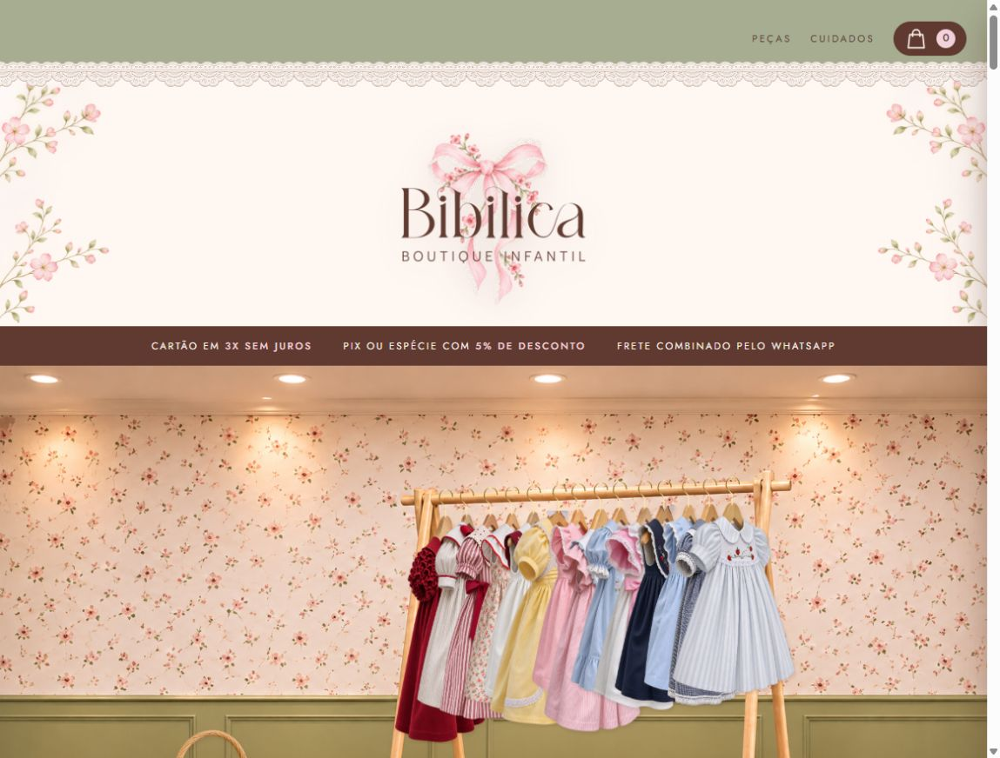
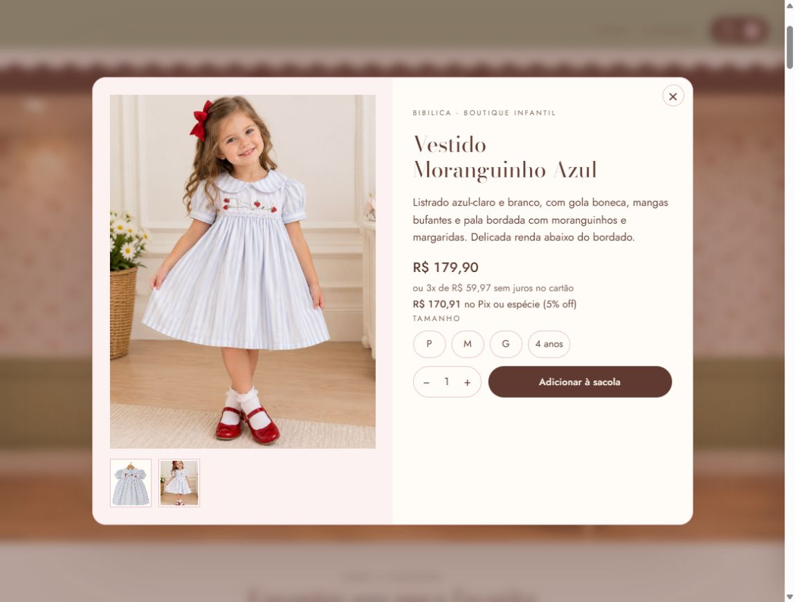

# Bibilica Boutique Infantil

Uma boutique infantil digital com vestidos pendurados em um cabideiro interativo, catálogo completo e pedidos organizados pelo WhatsApp.

**[Visite a loja](https://alannedias.github.io/bibilica-loja/)**

## Apresentação atual

## A experiência

- Passe o mouse sobre um vestido para destacá-lo de frente. Clique para ver fotos, preço, tamanhos e quantidade.
- Arraste uma peça até a cesta: a roupa entra visualmente, a cesta balança e a seleção de tamanho abre para confirmar a compra.
- Explore vestidos, conjuntos e rompers no catálogo abaixo do ambiente da loja.
- Reúna peças diferentes na mesma sacola e envie o pedido completo pelo WhatsApp. O site não processa pagamentos.
- No celular, toque na peça para abrir os detalhes e use o catálogo responsivo para comprar sem precisar arrastar.

A identidade combina creme, rosa suave, verde-sálvia e marrom, com flores em aquarela, renda marfim, madeira clara e cestas de vime.

## Estoque e pedidos

O estoque é consultado em uma planilha do Google Sheets. Cada tamanho tem sua quantidade, e a sacola respeita o limite disponível. Se a consulta falhar, o site utiliza o estoque de referência configurado no código.

A cliente escolhe moto táxi em Campina Grande, Correios ou retirada sem frete. Na retirada, o endereço é informado no ato do pagamento e não é solicitado endereço de entrega.

O pedido enviado ao WhatsApp inclui as peças, tamanhos, quantidades, entrega, endereço e forma de pagamento escolhida. A confirmação final é feita pela loja.

## Arquivos principais

| Arquivo | Conteúdo |
|---|---|
| `index.html` | Estrutura, cadastro de peças, estoque, totais e pedido pelo WhatsApp |
| `loja.css` | Identidade visual, ambiente, catálogo e animações |
| `loja.js` | Interação do cabideiro, detalhes das peças, catálogo e cesta |
| `encaixe-cabides.js` | Pontos de alinhamento das imagens ao cabideiro |
| `assets/` | Fotografias, recortes transparentes, logotipo e decoração |
| `estoque-bibilica.xlsx` | Modelo de organização do estoque |

## Manutenção

Os dados comerciais ficam no bloco **CONFIGURAÇÃO DA LOJA**, no `index.html`: WhatsApp, descontos, parcelas, entrega, peças e link da planilha.

Para cadastrar uma peça, adicione a fotografia em `assets/`, inclua seus dados em `PECAS` e atualize os tamanhos na planilha. A exibição no cabideiro também exige imagens transparentes de frente e de lado, além do alinhamento dos cabides; o catálogo pode usar diretamente a fotografia.

## Tecnologia e publicação

HTML, CSS e JavaScript, sem framework ou etapa de compilação. Publicação estática pelo GitHub Pages a partir da branch `main`.

**Design e desenvolvimento:** Alanne Dias · [@alannedias.designer](https://www.instagram.com/alannedias.designer/)
