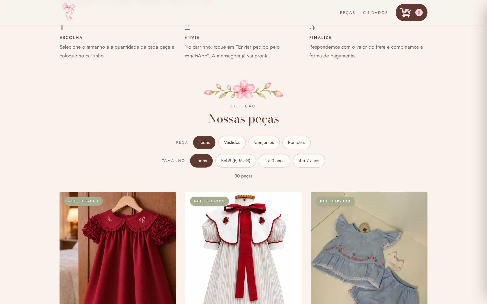
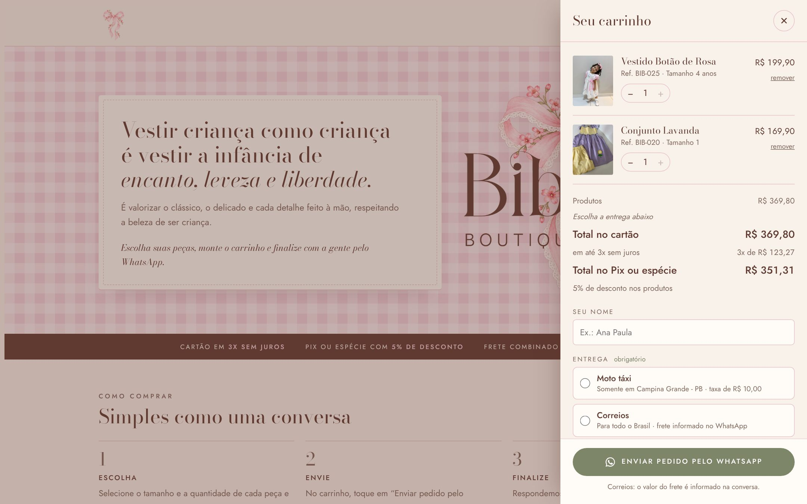

# Bibilica Boutique Infantil

**Online catalog with WhatsApp checkout for a children's boutique with hand-embroidered clothing.**
Catálogo online com pedido pelo WhatsApp para uma boutique infantil de roupas bordadas à mão.

🔗 **Live site:** [bibilica.netlify.app](https://bibilica.netlify.app)
🎨 **Design & development:** Alanne Dias · [@alannedias.designer](https://www.instagram.com/alannedias.designer/)

---

## The brief / O desafio

The client sells one-of-a-kind, hand-embroidered pieces and closes every sale personally on WhatsApp. She didn't want an online checkout — she wanted customers to **arrive with the order already organized**.

A cliente vende peças quase únicas, bordadas à mão, e fecha cada venda pessoalmente no WhatsApp. Ela não queria pagamento no site: queria que a cliente **chegasse na conversa com o pedido pronto**.

## The solution / A solução

- **Brand-led visual identity** — palette, typography and watercolor illustrations taken from the brand manual (gingham pink, olive green, deep brown, ivory).
- **Catalog with filters** by type (dresses, sets, rompers) and size range (baby, 1–3, 4–7 years).
- **Cart with real stock limits** — each size has its own quantity; sold-out sizes are struck through and fully sold-out pieces disappear.
- **Google Sheets as the stock back-office** — the owner edits one yellow column on her phone; the site reads it on every visit. No admin panel, no database.
- **Checkout that writes the WhatsApp message** — delivery (local moto-taxi with a fixed fee, or postal), full address and payment methods are required, totals are calculated (5% off for Pix/cash, fee added), and the message opens ready to send.
- **Photo galleries**, mobile-first layout and care instructions for hand embroidery in the footer.

| Carrinho | Celular |
|---|---|
|  |  |

## Tech / Tecnologia

Deliberately simple so the client can keep it running for free:

- One static `index.html` (HTML, CSS and vanilla JavaScript — no framework, no build step)
- Google Sheets (published CSV) as a lightweight inventory source
- `wa.me` deep links for the order message
- Hosted on Netlify, deployed from this repository

---

## Manual de uso (para a loja)

### O que tem aqui

| Arquivo | Para que serve |
|---|---|
| `index.html` | A loja inteira: visual, peças, carrinho e mensagem do WhatsApp |
| `assets/` | Fotos das peças, logo, laço e ilustrações |
| `estoque-bibilica.xlsx` | Modelo da planilha de estoque (a versão em uso está no Google Planilhas) |
| `docs/` | Imagens deste portfólio |

### Mudanças mais comuns

Tudo fica no bloco **CONFIGURAÇÃO DA LOJA**, no `<script>` do fim do `index.html`:

- **WhatsApp:** `const WHATSAPP = "5583988325972";`
- **Desconto Pix/espécie:** `const DESCONTO_PIX = 0.05;`
- **Parcelas no cartão:** `const PARCELAS = 3;`
- **Taxa do moto táxi:** `const TAXA_MOTO = 10.00;`

### Adicionar uma peça
1. Coloque a foto em `assets/` (vertical 4:5, de preferência 1000 px de largura).
2. Na lista `PECAS`, copie um bloco e troque os dados (`id`, `nome`, `descricao`, `preco`, `tamanhos`, `foto` e, se quiser, `fotosExtras`).
3. Inclua uma linha por tamanho na planilha de estoque.

### Estoque
- Coluna **Quantidade** = quantas peças existem daquele tamanho. **0** = esgotado.
- A planilha precisa estar compartilhada como **"Qualquer pessoa com o link" · Leitor**.
- Para conferir a leitura, abra o site com `#estoque` no fim do endereço (faixa verde = ok).
